# Software Architecture & System Diagrams

MD platform — architecture — architecture
overview, data-flow schematics, and component dependency maps.

All diagrams use [Mermaid](https://mermaid.js.org/) syntax (mindmap, flowchart,
sequence diagram). Render with any Mermaid-compatible viewer (VS Code preview,
GitHub, GitLab, etc.).

---

## 1. System Overview

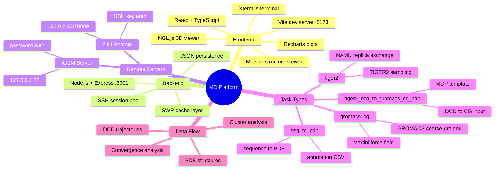

---

## 2. Backend Module Architecture

```mermaid
flowchart TB
    subgraph Entry["index.js — entry point"]
        E1[loadTasks]
        E2[loadFlows]
        E3[mountRoutes]
        E4[autoConnect]
    end

    subgraph Routes["routes/ — HTTP API"]
        R1["servers.js — CRUD + connect/disconnect"]
        R2["tasks.js — CRUD + SSH exec + run/pause/continue controls"]
        R3["flows.js — Flow CRUD + POST /:id/start"]
        R4["files.js — remote file browser"]
        R5["data.js — sim-status / structure / cluster / trajectory"]
        R6["transition.js — local task generation"]
        R7["video.js — VMD rendering"]
    end

    subgraph Services["services/ — business logic"]
        S1["ssh.js — SSH session pool + exec/upload/download"]
        S2["transition.js — runTransition (python3 generate.py)"]
        S3["flow-links.js — syncFlowLinks (symlink management)"]
        S4["task-dir.js — scaffoldTaskConfig + dir resolution"]
    end

    subgraph Store["store.js — JSON persistence"]
        ST1[serverStore]
        ST2[taskStore]
        ST3[flowStore]
    end

    subgraph Cache["cache.js — SWR cache"]
        C1[in-memory Map]
        C2[disk persistence]
        C3[warmUp on startup]
    end

    subgraph TaskTypes["tasktype/ — plugin system"]
        T1["tiger2/ — main.py + lib/ + routes/"]
        T2["gromacs_cg/ — main.py + lib/ + routes/"]
        T3["seq_to_pdb/ — generate.py (local)"]
        T4["tiger2_dcd_to_gromacs_cg_pdb/ — generate.py (local)"]
    end

    E1 --> ST2
    E2 --> ST3
    R1 --> S1
    R2 --> S1
    R2 --> S4
    R3 --> S3
    R6 --> S2
    S2 --> T3
    S2 --> T4
    S4 --> T1
    S4 --> T2
    R5 --> C1
    C1 --> C2
    C3 --> C1

    style Entry fill:#e1f5fe
    style Routes fill:#f3e5f5
    style Services fill:#e8f5e8
    style Store fill:#fff3e0
    style Cache fill:#fce4ec
    style TaskTypes fill:#f1f8e9
```

---

## 3. Task Type Plugin System

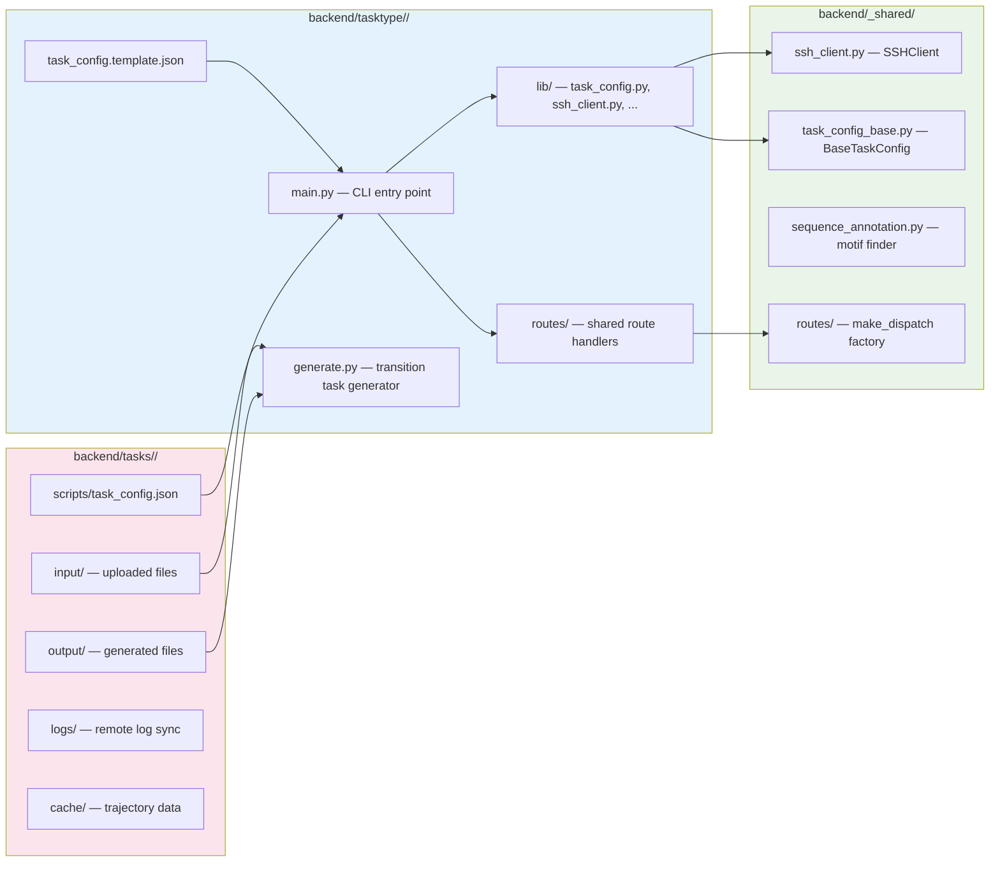

---

## 4. Flow Pipeline System

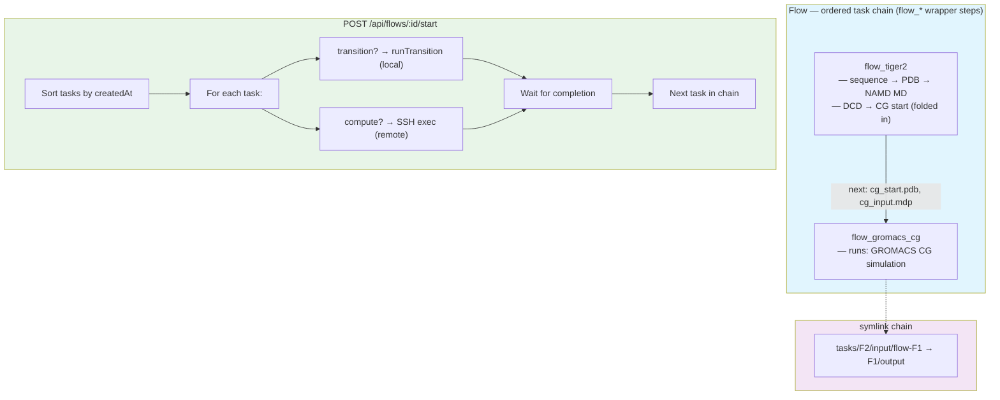

---

## 5. Transition Task Data Flow

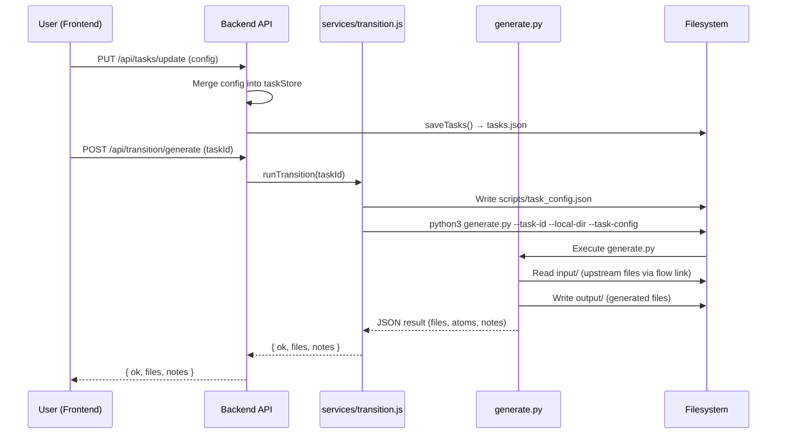

---

## 6. Task Creation: Template Extraction

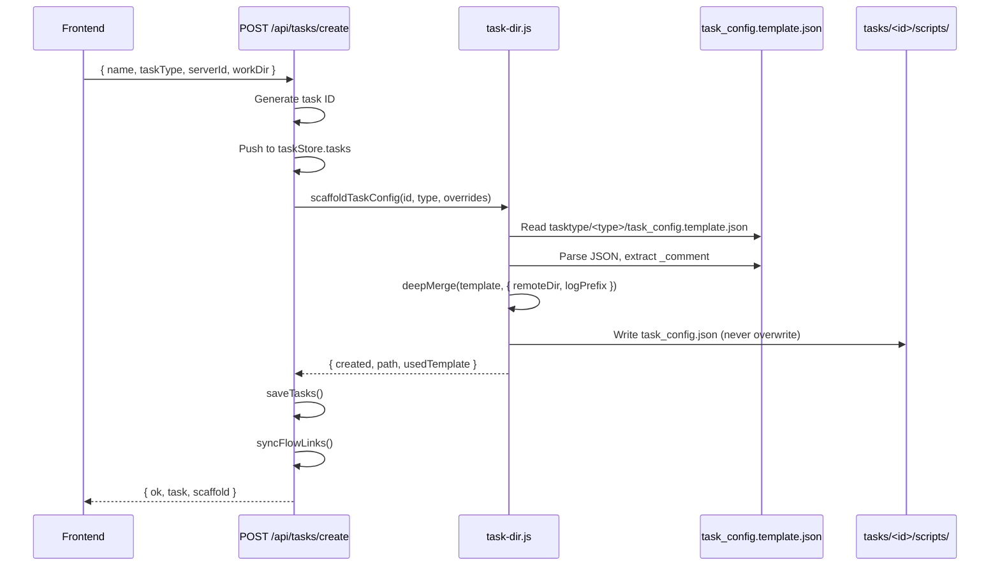

---

## 7. Frontend Component Tree

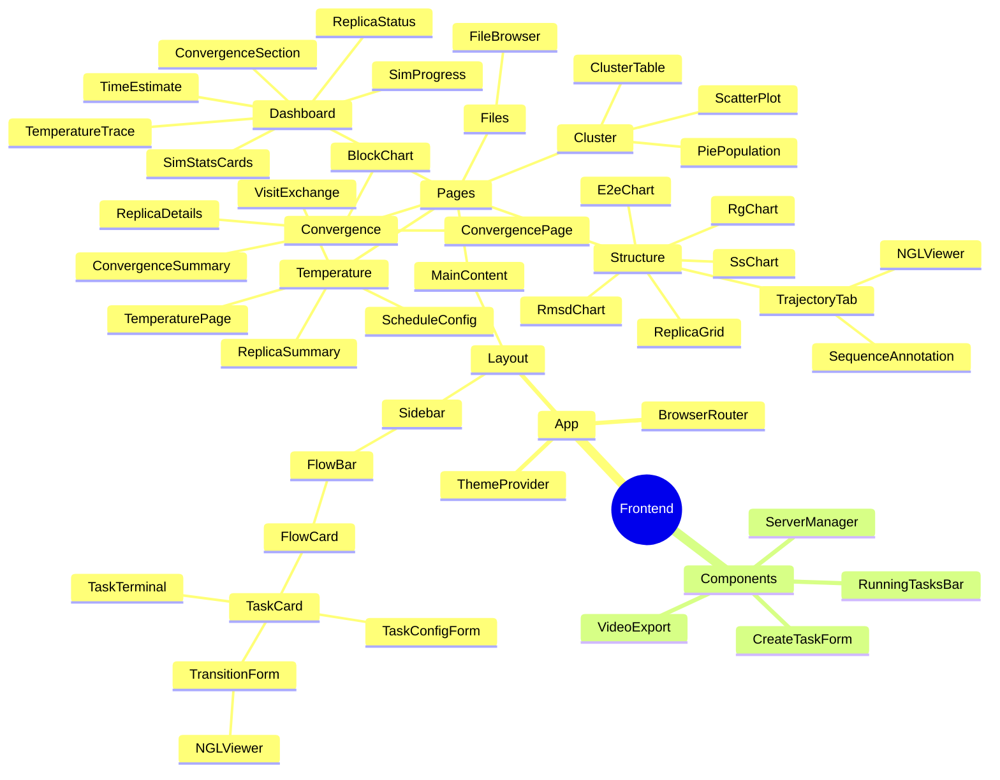

---

## 8. Data Flow: Simulation → Visualization

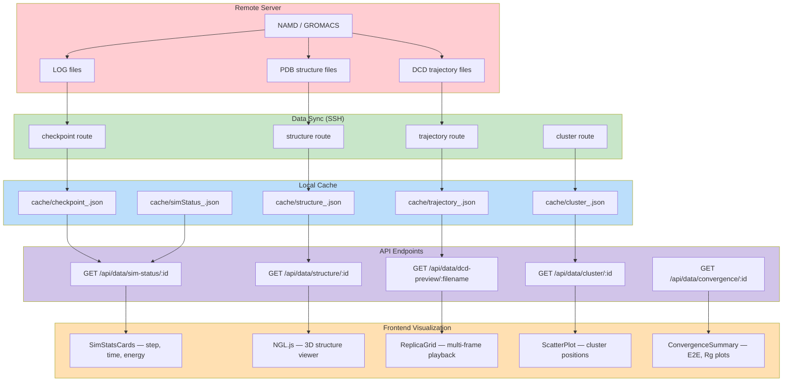

---

## 9. Sequence Annotation System

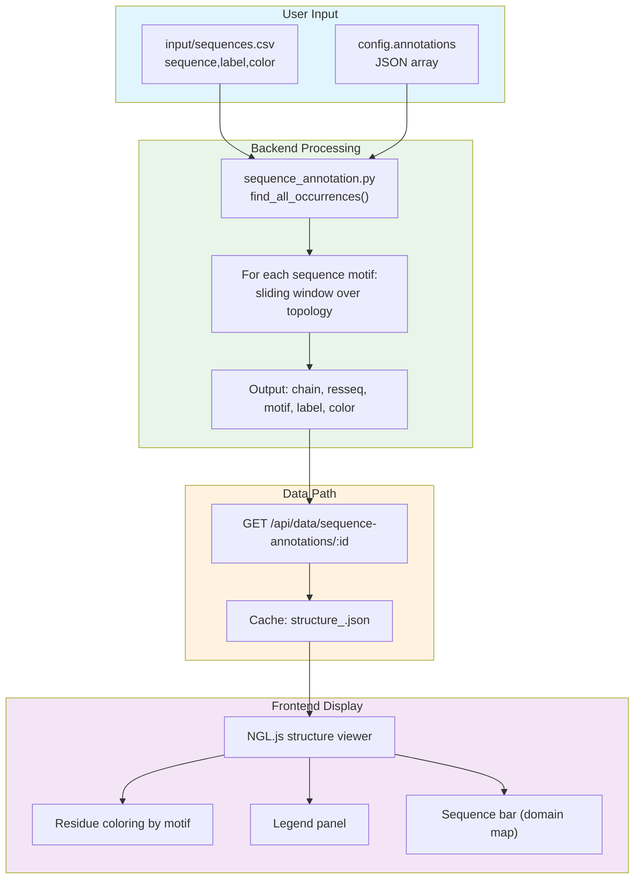

---

## 10. DCD Parser: CHARMM vs NAMD 3 Format

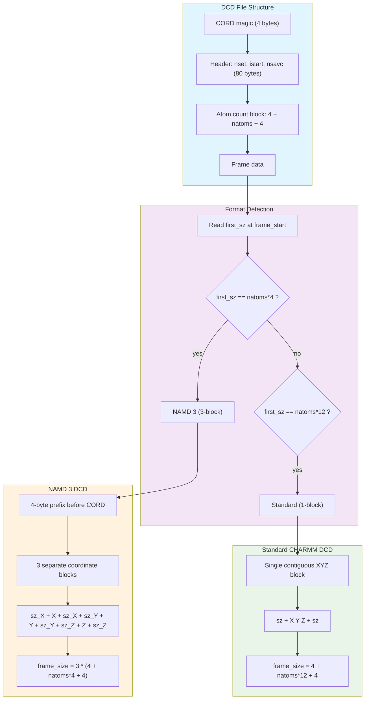

---

## 11. File System Layout

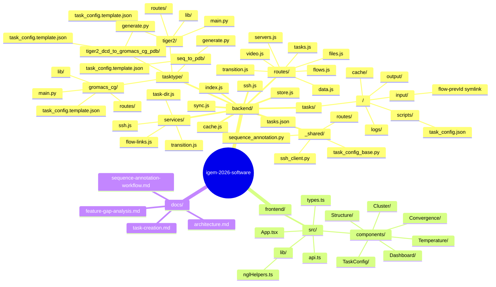

---

## 12. Key Design Patterns

```mermaid
mindmap
  root((Design Patterns))
    Plugin Architecture
      tasktype/ as plugin tree
      main.py route dispatch
      lib/ for domain logic
      routes/ as thin wrappers
      _shared/ for cross-type code
    SWR Cache
      stale-while-revalidate
      in-memory + disk persistence
      warmUp on startup
      expireCache for soft invalidation
    Flow Pipeline
      tasks ordered by createdAt
      symlinks for file access
      next[] for output-to-input mapping
      POST /:id/start for sequential launch
    Transition Tasks
      local execution (no SSH)
      generate.py CLI scripts
      scaffoldTaskConfig for templates
      task_config.json per task
    SSH Session Pool
      persistent connections
      exec/upload/download
      auto-reconnect on failure
      session caching by serverId
    JSON Persistence
      tasks.json for all task data
      flows.json for flow definitions
      servers.json for server configs
      saveTasks() for atomic writes
```
