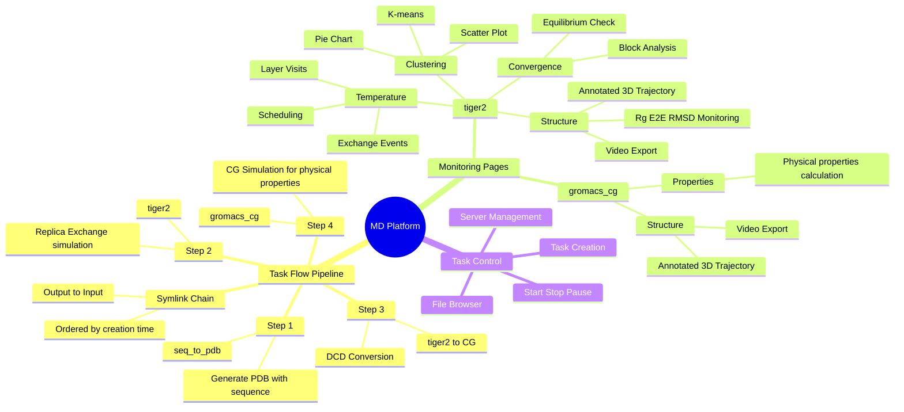

# Molecular Dynamics Platform — User Guide

## Mindmap

## Core Framework Status

### What You Have (Complete)

| Component | Status |
|-----------|--------|
| Task Pipeline (4 steps) | ✅ Complete |
| TIGER2 monitoring | ✅ Convergence, Temperature, Structure, Clustering |
| GROMACS CG monitoring | ✅ Structure, Properties |
| Transition tasks | ✅ seq_to_pdb, DCD→CG |
| Flow management | ✅ Symlink chain, sequential execution |
| Task control | ✅ CRUD, file browser, server management |
| Visualization | ✅ 3D viewer, video export, charts |

### Possible Extensions (Future)

| Feature | Priority | Notes |
|---------|----------|-------|
| Multi-run comparison | Medium | Compare multiple simulations side-by-side |
| Data export (CSV/JSON) | Low | For external analysis tools |
| Notification system | Low | Alert on completion/failure |
| GPU/resource monitoring | Low | Track compute usage |
| Batch job queue | Low | Manage multiple pending jobs |

**Your core framework is solid.** The pipeline covers the full MD workflow: structure preparation → simulation → analysis → coarse-graining. Monitoring pages match task capabilities. Extensions can be added incrementally as needed.
